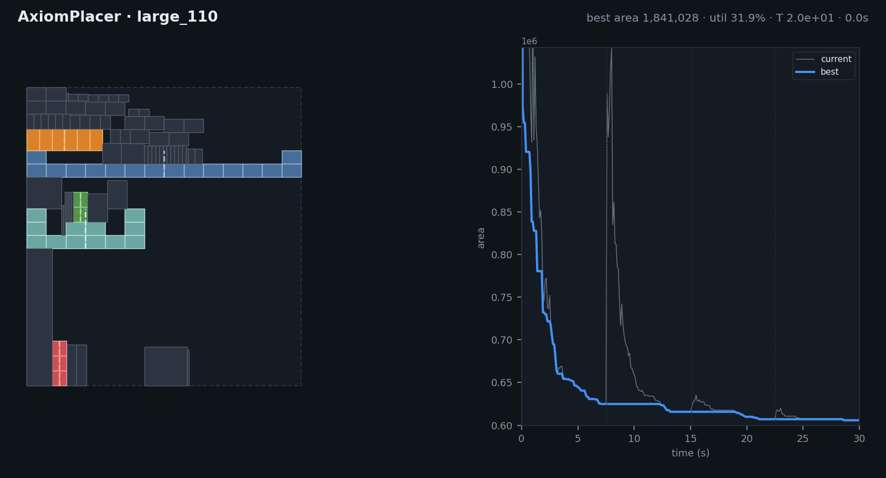
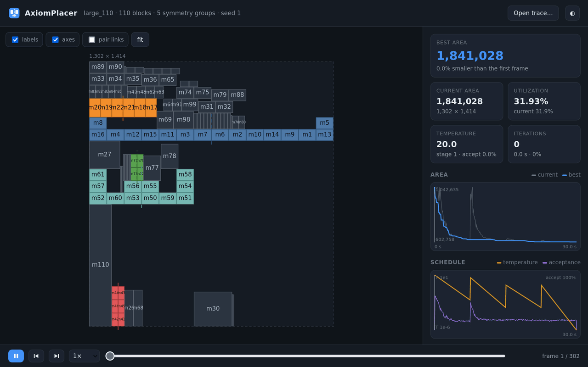
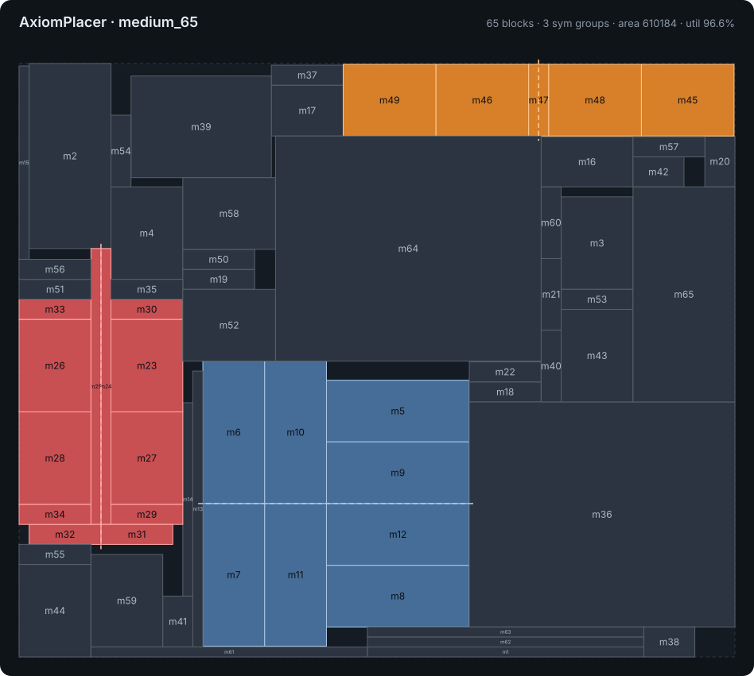
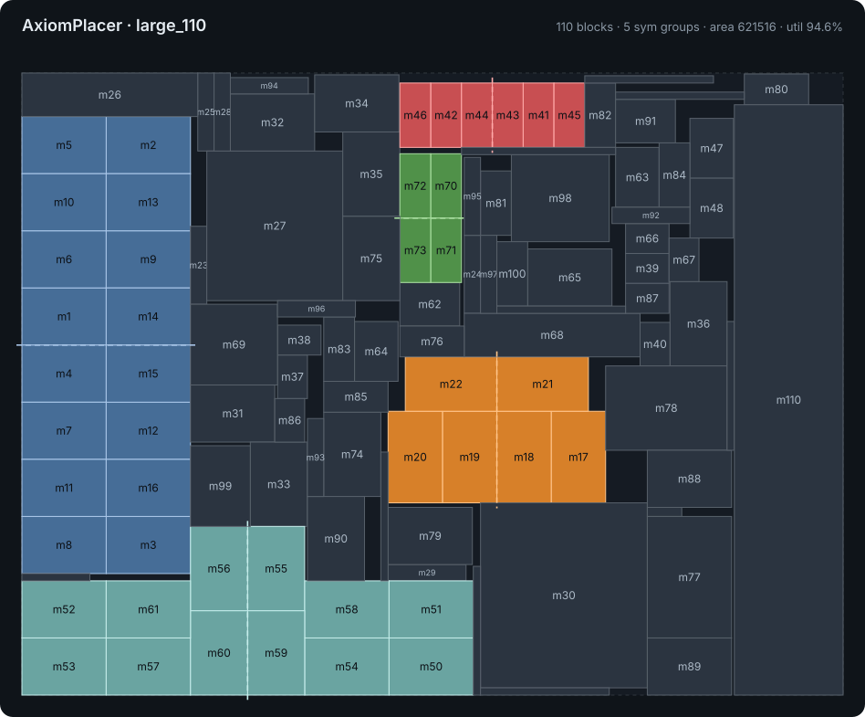

<div align="center">

# AxiomPlacer

**Symmetry-aware analog placement with HB\*-trees and simulated annealing.**

[](https://github.com/RayChang987/AxiomPlacer/actions/workflows/ci.yml)




</div>

AxiomPlacer places the devices of an analog circuit (transistors, capacitors,
resistors) so that the total bounding-box area is minimal, while every
**symmetry group** stays mirror-symmetric about a vertical or horizontal axis,
the way matched devices have to be laid out in real analog design.

* **Symmetry islands, guaranteed legal.** Each symmetry group is packed as
  one connected island from half of its devices and then mirrored, so every
  intermediate solution is symmetric by construction. No penalty terms and no
  repair step are needed.
* **Hierarchical B\*-tree (HB\*-tree).** Islands and free blocks are
  modules of a top-level B\*-tree. Islands can switch their axis between
  vertical and horizontal during the search.
* **Contour-aware packing.** The skyline is a segment tree, and islands drop
  into notches under their own overhangs instead of resting on their bounding
  box.
* **Fast.** Allocation-free evaluation runs about 45k–350k moves per second on
  the bundled instances, and a 60 s run reaches roughly 95–99 % utilisation.
* **Watch it think.** A zero-dependency web viewer can replay a run or follow
  it live. It shows the temperature schedule, the acceptance rate and the area
  curve.

## Quick start

```bash
git clone https://github.com/RayChang987/AxiomPlacer.git && cd AxiomPlacer
cmake -B build && cmake --build build -j

./build/axiom-placer benchmarks/large_110.txt large.out --time 30 --seed 1 --svg large.svg
python3 tools/verify.py benchmarks/large_110.txt large.out
```

```
AxiomPlacer 1.0.0 | large_110: 110 blocks, 5 symmetry groups | seed 1
  [100.0%] stage 4  T=1e-06      area 623565       best 623565       util  94.3%  1384.2k it
large_110: area 623565 (837 x 745), utilization 94.26%, initial 1841028, 30.0s
PASS  area 623565 (837 x 745), utilization 94.26%
```

Runs are time-limited, so results vary slightly from run to run, even with
the same seed. Use `--iters` for bit-exact reproducibility.

Requirements: a C++17 compiler (tested with GCC 9.4) and CMake ≥ 3.14.
The Python tools need only the standard library, except `render.py`, which
needs matplotlib and Pillow.

## Usage

```
axiom-placer <input.txt> <output.out> [options]

  -t, --time <sec>      time budget in seconds (default: 30)
  -n, --iters <n>       iteration budget instead of time (deterministic with --seed)
  -s, --seed <n>        random seed (default: random)
      --trace <file>    record the optimisation as JSON Lines for viewer/index.html
      --trace-fps <n>   snapshots per second in the trace (default: 10)
      --svg <file>      render the final placement as SVG
      --stats           print per-move acceptance statistics
  -q, --quiet           only print the final result
```

The input and output formats are specified in
[docs/FORMAT.md](docs/FORMAT.md).

## Visualising the optimisation



**Follow a run live.** The script starts a local server, prints the viewer URL
and streams the run into it:

```bash
tools/live.sh benchmarks/large_110.txt --time 60
# viewer: http://127.0.0.1:8000/viewer/?trace=../runs/large_110.jsonl&live=1
```

**Replay a recorded run.** Open `viewer/index.html` (straight from disk is
fine) and drop a trace file onto it:

```bash
./build/axiom-placer benchmarks/medium_65.txt out.out --trace run.jsonl
```

In the viewer you can scrub the timeline or click the charts to jump to a
moment, use <kbd>Space</kbd> to play, <kbd>←</kbd>/<kbd>→</kbd> to step and
<kbd>F</kbd> to re-fit. The wheel zooms, dragging pans, hovering a block
highlights its mirror partner, and clicking a symmetry group isolates it.

**Static output.** `--svg` writes a standalone image, and `tools/render.py`
turns a trace into a GIF, a PNG or a convergence plot:

```bash
python3 tools/render.py run.jsonl --gif run.gif --png final.png --curve curve.png
```

`tools/record_viewer.mjs` records the web viewer replaying a trace as a GIF
(the animation above). It needs Node ≥ 22, Firefox and ffmpeg:

```bash
node tools/record_viewer.mjs run.jsonl viewer.gif --frames 60 --width 1280
```

## Results

60-second runs on a single core, 3 seeds each (`--time 60 --seed {1,2,3}`).
Every result passes `tools/verify.py`.

| instance | blocks | sym. groups | best area | median area | utilisation (best) |
|----------|-------:|------------:|----------:|------------:|-------------------:|
| `small_09`  |   9 | 1 | 46,924,848 | 46,924,848 | 99.23 % |
| `demo_16`   |  16 | 1 |     68,208 |     69,776 | 98.08 % |
| `medium_65` |  65 | 3 |    611,632 |    613,872 | 96.35 % |
| `large_110` | 110 | 5 |    610,736 |    613,050 | 96.24 % |

<table>
<tr>
<td></td>
<td></td>
</tr>
</table>

Coloured blocks belong to symmetry groups (one colour per group) and the
dashed lines are their axes. Grey blocks are unconstrained.

## How it works

```
problem ─► Floorplanner ─► initial HB*-tree ─► Annealer ──► best HB*-tree ─► Placement
               │                                  │  ▲
               │                                  ▼  │ cost = bounding-box area
               └──── island layouts (cached) ◄── pack()
```

1. Every symmetry group becomes an **island**. Only one block of each pair
   (plus the self-symmetric blocks at half size) lives in the island's
   B\*-tree. After packing, that half is mirrored across the axis.
2. Islands and the remaining blocks are modules of a **top-level B\*-tree**,
   which is packed against a segment-tree contour.
3. **Simulated annealing** applies one of nine moves per step (subtree
   shifts, swaps, rotations, axis flips, …) and uses the Metropolis
   criterion on the relative area change. Four cooling stages each restart
   from the best solution so far.

[docs/ALGORITHM.md](docs/ALGORITHM.md) has the full description, including
how self-symmetric blocks are kept on the axis and how islands are dropped
into the contour.

## Project layout

```
include/axiom/   public headers: problem, skyline, B*-tree, floorplan, annealer, report
src/             library implementation
apps/            command-line front end (axiom-placer)
tests/           unit tests (no external framework)
viewer/          single-file web GUI for traces
tools/           verify.py · gen_bench.py · render.py · record_viewer.mjs · live.sh
benchmarks/      sample instances (9–110 blocks)
docs/            file formats, algorithm notes, images
```

## Development

```bash
cmake -B build -DCMAKE_BUILD_TYPE=Debug && cmake --build build -j
(cd build && ctest --output-on-failure)          # unit tests + place & verify every benchmark

# random instances for stress testing
python3 tools/gen_bench.py --blocks 300 --groups 8 --seed 7 > /tmp/r300.txt
./build/axiom-placer /tmp/r300.txt /tmp/r300.out -t 20 && python3 tools/verify.py /tmp/r300.txt /tmp/r300.out
```

## License

[MIT](LICENSE)
